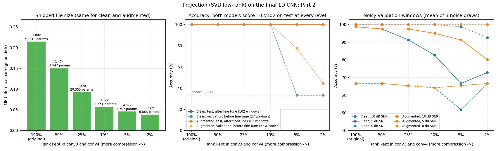
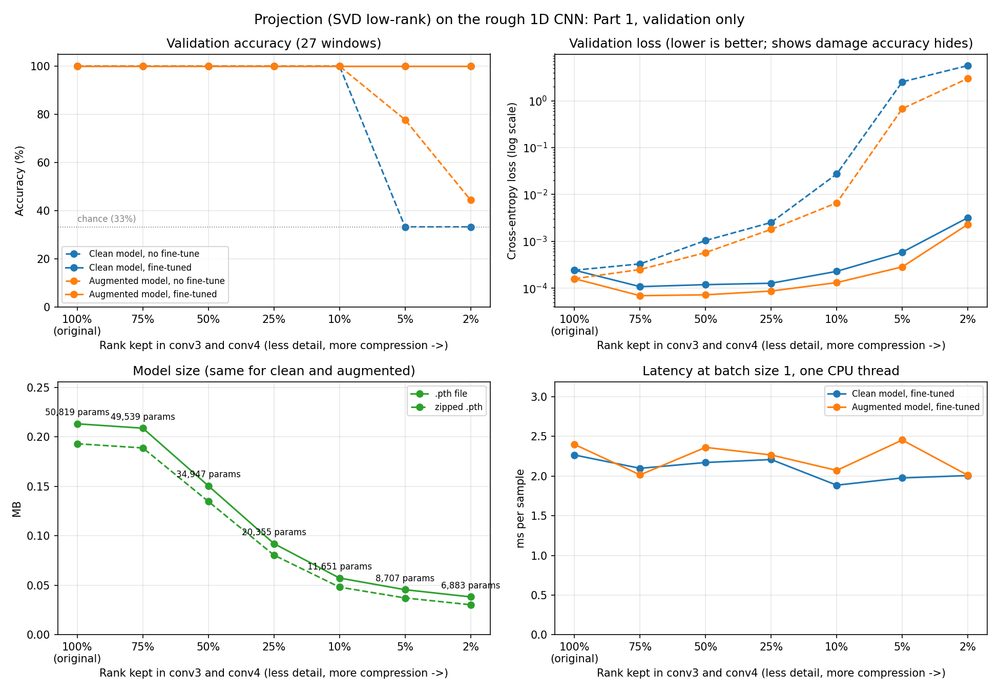

# Projection: Results and Write-up

Sabina · Issue [#19](https://github.com/Break-Through-Tech/MathWorks-1C-unlocking-embedded-ai-through-efficient-compression/issues/19) · October compression task: projection

**Status:** Part 1 (code and validation sweep on the rough model) and Part 2
(final models, test scores, noise robustness, `results/experiments.csv`) are
done. The MATLAB comparison has not been run yet (see
[MATLAB comparison](#matlab-comparison)). Latency in `experiments.csv` was
measured on a Windows laptop; the official Colab CPU timing is
`notebooks/08_projection_colab.ipynb`.

## What projection is

A trained network stores what it learned as big tables of numbers (weights).
Projection replaces one big table with two thin tables that, multiplied
together, give almost the same result. It keeps the most important patterns in
the layer and drops the least important ones. How much "detail" to keep is a
dial: keep all of it and the layer behaves exactly as before; keep less and
the layer gets smaller but slightly less precise.

Technically, each selected `Conv1d(in, out, k)` becomes
`Conv1d(in, r, k) -> Conv1d(r, out, 1)`, with weights from a truncated SVD of
the layer's `out x (in*k)` weight matrix. `r` is the rank, the "detail kept".

**Why it matters here.** Pruning, our other technique, sets weights to zero
but leaves the tables the same shape, so a normal pruned `.pth` stays
0.215 MB and has to be saved in a sparse format to shrink. Projection makes
the tables physically smaller, so the ordinary saved file shrinks.

## What we projected and why

The two last conv layers hold 89% of the model's 50,819 parameters, so those
are the ones split (`python -m src.cnn_1D.cnn_project --report`):

| Layer | Weight shape | Params | Share | Full rank | Break-even rank |
|---|---|---:|---:|---:|---:|
| conv4 (`features.12`) | 96 x 64 x 5 | 30,816 | 60.6% | 96 | 73 |
| conv3 (`features.8`) | 64 x 32 x 7 | 14,400 | 28.3% | 64 | 49 |
| conv2 (`features.4`) | 32 x 16 x 9 | 4,640 | 9.1% | 32 | 26 |
| everything else | | 963 | 1.9% | | |

**Break-even rank:** two thin layers only use fewer weights than the original
below this rank. Keeping 75% of the rank (72 and 48) is just under break-even,
so it saves almost nothing; Part 2 starts at 50%.

The weights are not naturally low-rank: keeping 90% of the singular-value
"energy" already needs rank 68 of 96 and 47 of 64, close to break-even. So the
dial is set by **fraction of rank**, and the brief retraining does the work of
recovering accuracy.

## Final results (Part 2)

**Models projected:** Gurbaj's two frozen original-width packages,
`cnn_outputs/final_models/original_reference_seed42.pth` (the team's
compression reference, trained on clean data) and
`cnn_outputs/augmentation_models/original_both_seed42.pth` (same architecture,
trained with time shifts and 20 dB noise). They hold exactly the same weights
as the rough checkpoints Part 1 used (checked in `cnn_projection_test.py`).

**Method:** keep 50, 25, and 10% of conv3 and conv4's rank (the levels in the
issue), plus 5 and 2% to find the floor. Each projected model is fine-tuned
for 15 epochs at lr=1e-4 (the same as pruning), keeping the epoch with the
lowest validation loss; the augmented model is fine-tuned with its own
augmentation. Every model is saved as an inference package in the same
layout as Gurbaj's (`model.pth`: weights, normalization, class names, and the
ranks), so its size on disk is the shipped size. The test split was scored
once, after all models were built.



| Rank kept | conv3 / conv4 rank | Params | Shipped file (MB) | Smaller by | Test acc after fine-tune (clean / aug) | Val acc before fine-tune (clean / aug) | Test loss (clean / aug) |
|---|---|---:|---:|---:|---|---|---|
| 100% (original) | 64 / 96 | 50,819 | 0.2148 | 1.00x | 100% / 100% | n/a | 0.00029 / 0.00024 |
| 50% | 32 / 48 | 34,947 | 0.1509 | 1.42x | 100% / 100% | 100% / 100% | 0.00013 / 0.00011 |
| 25% | 16 / 24 | 20,355 | 0.0925 | 2.32x | 100% / 100% | 100% / 100% | 0.00014 / 0.00013 |
| 10% | 6 / 10 | 11,651 | 0.0577 | 3.72x | 100% / 100% | 100% / 100% | 0.00023 / 0.00017 |
| 5% | 3 / 5 | 8,707 | 0.0459 | 4.68x | 100% / 100% | 33% / 78% | 0.00051 / 0.00042 |
| 2% | 1 / 2 | 6,883 | 0.0386 | 5.56x | 100% / 100% | 33% / 44% | 0.0064 / 0.0052 |

Test accuracy is 102/102 for every model. Latency (batch size 1, one thread,
including normalization) was 3.0–3.6 ms on the Windows laptop at every level,
with no trend; the Colab numbers will replace these.

### Noise and time shifts

Gurbaj's validation robustness suite: the 27 validation windows with Gaussian
noise at 20, 15, 10, 5, and 0 dB SNR (3 fixed noise draws each, so 81
predictions per cell) and four circular shifts. The windows are regenerated
with his seeds, and the two dense models reproduce his recorded results
exactly. Full data: `results/projection_robustness.csv`.

| Rank kept | 10 dB (clean / aug) | 5 dB (clean / aug) | 0 dB (clean / aug) |
|---|---|---|---|
| 100% (original) | 100% / 100% | 99% / 99% | 67% / 67% |
| 50% | 100% / 100% | 98% / 98% | 67% / 67% |
| 25% | 100% / 100% | 91% / 98% | 65% / 65% |
| 10% | 100% / 100% | 83% / 95% | 64% / 64% |
| 5% | 99% / 100% | 67% / 91% | 52% / 65% |
| 2% | 93% / 100% | 73% / 80% | 67% / 67% |

Every model scores 100% at 20 and 15 dB and under all four time shifts.

## Trade-offs

Projection gives a real file-size reduction with no special file format: up
to 5.6x smaller (0.215 to 0.039 MB), and every level still scores 102/102 on
the clean test set after 15 epochs of fine-tuning. It also cuts the
arithmetic (57% of the original multiply-adds at 10% rank, 51% at 2%), but
that did not make it measurably faster on a laptop CPU: at batch size 1 such
a small model's time goes mostly into fixed per-call overhead (normalization,
tensor conversion, one call per layer), so the saving may only show on a
device where arithmetic dominates. The real cost of compression shows up under noise rather than on the
clean test set: at 5 dB SNR the clean model drops from 99% to 83% at 10% rank
and 67% at 5% rank. Training and fine-tuning with augmentation largely
protects against this (95% and 91% at the same levels), which makes **the
augmented model at 10% rank the best operating point: 3.7x smaller, 100% on
test, 100% at 10 dB, and 95% at 5 dB**. Below 5% rank, the layers that were not
projected (mostly conv2) make up most of the model, so going smaller needs
projecting conv2 as well or combining projection with quantization.

### Clean vs augmented (the CA's question)

Before compression, augmentation made no measurable difference (99% vs 99%
at 5 dB, 67% vs 67% at 0 dB), which matches Gurbaj's finding of no consistent
augmentation advantage. Once the model is compressed, the difference appears.
The augmented model loses less accuracy before fine-tuning (78% vs 33% at 5%
rank), has lower test loss at every level, and holds up much better at 5 dB
(91% vs 67% at 5% rank). So augmentation does not help much on its own, but
it makes the model more tolerant of compression. Note that the augmented
models were also *fine-tuned* with augmentation, so this compares the whole
recipe, not the original training alone. At 0 dB (noise as strong as the
signal) every model, compressed or not, sits around 65%; that limit comes
from the original model, not from projection.

### How it compares (context for the final charts)

At a similar size, INT8 quantization (Venya, 0.059 MB) and 10% projection
(0.058 MB) both keep 100% test accuracy, and the two can be stacked (see
handoffs). Gurbaj's micro CNN (923 parameters, 0.014 MB, 100% test) is smaller
than any projected model, because it was trained small from the start.
Projection's value is shrinking an already-trained model with a short
fine-tune, not beating a network designed to be tiny. These sizes come from
different scripts and sessions; Farheen's final charts will put them side by
side.

## MATLAB comparison

MATLAB's `compressNetworkUsingProjection` uses a different idea from our
code. Ours splits each layer using the SVD of its **weights**, without looking
at any data. MATLAB first runs training data through the network
(`neuronPCA`) and keeps the directions the layer's **activations** actually
use. A data-aware method may lose less accuracy before fine-tuning, which is
what the comparison should show.

**Status: not yet run.** It will be done in MATLAB Online (Deep Learning
Toolbox and its Model Compression Library). The plan is to rebuild the same
CNN in MATLAB with the final reference weights and check that it gives the
same outputs as Python. Then conv3 and conv4 get compressed to the same
parameter counts as the five Python models and fine-tuned with the same
settings (Adam, lr 1e-4, 15 epochs, best validation loss). The comparison
covers accuracy before and after fine-tuning and test accuracy at each size.
MATLAB file sizes and timings are measured differently from Python's, so
they will be compared within the MATLAB results only.

## Handoffs

- **Aigerim (projection + quantization, [#30](https://github.com/Break-Through-Tech/MathWorks-1C-unlocking-embedded-ai-through-efficient-compression/issues/30)):**
  load a projected model with `load_model()` from `src/cnn_1D/cnn_project.py`.
  In Venya's `QuantizableBearingCNN.fuse()`, conv3 and conv4 are now pairs,
  so the fuse groups become `["0","1","2"], ["4","5","6"], ["8.1","9","10"],
  ["12.1","13","14"]` (`8.0` and `12.0` stay as plain convs). A quick check of
  10% rank + static INT8 gave a 0.028 MB state dict with test predictions
  identical to the FP32 projected model. The Windows PyTorch build only has
  the `onednn` backend, which `pick_backend()` does not list, so run it on
  Colab.
- **Tule (fair re-benchmark, [#29](https://github.com/Break-Through-Tech/MathWorks-1C-unlocking-embedded-ai-through-efficient-compression/issues/29)):**
  the shipped files are `cnn_outputs/projected/<source>/rank_<level>pct/model.pth`.
  `log_projection_results.py` shows the timed call (raw window in, includes
  normalization, same as Gurbaj's final benchmark).
- **Farheen (final charts, [#31](https://github.com/Break-Through-Tech/MathWorks-1C-unlocking-embedded-ai-through-efficient-compression/issues/31)):**
  `results/projection_final.csv` (size, accuracy, latency per level) and
  `results/projection_robustness.csv` (same windows as Gurbaj's suite).
- **Venya (merge, [#28](https://github.com/Break-Through-Tech/MathWorks-1C-unlocking-embedded-ai-through-efficient-compression/issues/28)):**
  this branch adds `experiment_id` 1–12, which will need renumbering. The two
  source packages are byte-identical copies of the files on
  `feature/1d-cnn-optimization`, so they merge cleanly.

## Caveats

- The clean test set cannot tell the levels apart: everything scores 102/102.
  Test loss and the noise suite are the signals that separate them.
- One training seed per model. The noise suite reuses the same 27 validation
  windows (81 predictions per cell are not independent), and those windows
  also chose the fine-tuning epoch (by clean validation loss).
- Noise is synthetic Gaussian noise. One test rig; recording-level
  independence between splits is unverified (see `src/cnn_1D/README.md`).
- Laptop latency is not comparable with numbers from other machines; use the
  Colab run.

## Part 1 (October): validation sweep on the rough model

Part 1 projected the rough checkpoints (same weights as the final models) at
75 to 2% rank, before and after fine-tuning, on validation only. Full data:
`results/projection_sweep.csv`.



| Rank kept | conv3 / conv4 rank | Params | .pth (MB) | Zipped (MB) | Smaller by | Val acc before fine-tune (clean / aug) | Val acc after fine-tune (clean / aug) |
|---|---|---:|---:|---:|---:|---|---|
| 100% (original) | 64 / 96 | 50,819 | 0.213 | 0.193 | 1.00x | 100% / 100% | n/a |
| 75% | 48 / 72 | 49,539 | 0.209 | 0.189 | 1.02x | 100% / 100% | 100% / 100% |
| 50% | 32 / 48 | 34,947 | 0.151 | 0.135 | 1.42x | 100% / 100% | 100% / 100% |
| 25% | 16 / 24 | 20,355 | 0.092 | 0.081 | 2.31x | 100% / 100% | 100% / 100% |
| 10% | 6 / 10 | 11,651 | 0.057 | 0.048 | 3.72x | 100% / 100% | 100% / 100% |
| 5% | 3 / 5 | 8,707 | 0.046 | 0.037 | 4.68x | 33% / 78% | 100% / 100% |
| 2% | 1 / 2 | 6,883 | 0.038 | 0.030 | 5.57x | 33% / 44% | 100% / 100% |

Part 2 reproduces these validation numbers exactly (same seed and settings).
The sizes here are bare state dicts; Part 2's are the full inference packages.
Part 1 attributed the flat latency to conv1 and conv2 doing most of the
computation; counting multiply-adds shows conv3 and conv4 do about half of
it, so the flat latency comes from per-call overhead instead (see
Trade-offs).

## Reproducing

```bash
python -m src.cnn_1D.cnn_projection_test      # correctness checks (11)
python -m src.cnn_1D.cnn_project --report     # layer sizes and SVD spectra
python -m src.cnn_1D.projection_build         # build + save the 10 final models (no test data)
python -m src.cnn_1D.projection_robustness    # noise/shift suite -> results/projection_robustness.csv
python -m src.cnn_1D.log_projection_results   # test, size, latency -> results/projection_final.csv
python -m src.cnn_1D.log_projection_results --save   # also write results/experiments.csv
python results/projection_final_plot.py       # chart -> results/projection_final.png

# Part 1
python -m src.cnn_1D.projection_sweep         # -> results/projection_sweep.csv
python results/projection_plot.py             # -> results/projection_sweep.png
```

## Files

| File | Purpose |
|---|---|
| `src/cnn_1D/cnn_project.py` | Projection pipeline: layer report, SVD split, fine-tune, save/load packages |
| `src/cnn_1D/cnn_projection_test.py` | Correctness checks |
| `src/cnn_1D/projection_build.py` | Builds the final projected models |
| `src/cnn_1D/projection_robustness.py` | Gurbaj's noise/shift suite on every model |
| `src/cnn_1D/log_projection_results.py` | Final measurements and `experiments.csv` rows |
| `notebooks/08_projection_colab.ipynb` | Official Colab CPU timing run |
| `cnn_outputs/projected/` | The 10 projected models (`model.pth` + `run_info.json`) |
| `results/projection_final.csv`, `results/projection_robustness.csv`, `results/projection_final.png` | Part 2 results |
| `src/cnn_1D/projection_sweep.py`, `results/projection_plot.py`, `results/projection_sweep.*` | Part 1 |
