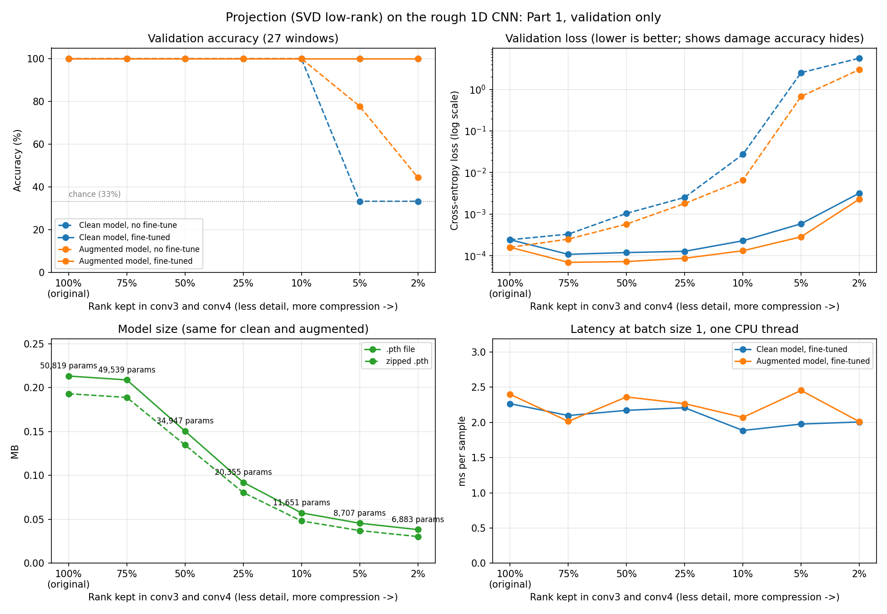

# Projection: Part 1 Results and Write-up

Sabina · October compression task: projection

**Status:** Part 1 (build and test the code on Gurbaj's rough model) is done.
Part 2 (final runs with test-set scores, logged to `results/experiments.csv`) is next. All numbers below are **validation only**; the test set has not been used yet.

## What projection is

A trained network stores what it learned as big tables of numbers (weights).
Projection replaces one big table with two thin tables that, multiplied
together, give almost the same result. It keeps the most important patterns in
the layer and drops the least important ones. How much "detail" to keep is a
dial: keep all of it and the layer behaves exactly as before; keep less and
the layer gets smaller but slightly less precise.

Technically, each selected `Conv1d(in, out, k)` becomes
`Conv1d(in, r, k) -> Conv1d(r, out, 1)`, with weights from a truncated SVD of
the layer's `out x (in*k)` weight matrix. `r` is the rank, the "detail kept".

**Why it matters here.** Pruning, our other technique, sets weights to zero
but leaves the tables the same shape, so Aigerim's pruned files all stayed
0.213 MB. Projection makes the tables physically smaller, so the saved file
really shrinks without needing a zip step.

## What we projected and why

The two last conv layers hold 89% of the model's 50,819 parameters, so those
are the ones split (`python -m src.cnn_1D.cnn_project --report`):

| Layer | Weight shape | Params | Share | Full rank | Break-even rank |
|---|---|---:|---:|---:|---:|
| conv4 (`features.12`) | 96 x 64 x 5 | 30,816 | 60.6% | 96 | 73 |
| conv3 (`features.8`) | 64 x 32 x 7 | 14,400 | 28.3% | 64 | 49 |
| conv2 (`features.4`) | 32 x 16 x 9 | 4,640 | 9.1% | 32 | 26 |
| everything else | | 959 | 1.9% | | |

**Break-even rank:** two thin layers only use fewer weights than the original
below this rank. Keeping 75% of the rank (72 and 48) is just under break-even,
so it saves almost nothing.

The weights are not naturally low-rank: keeping 90% of the singular-value
"energy" already needs rank 68 of 96 and 47 of 64, close to break-even. So the
dial is set by **fraction of rank**, and the brief retraining does the work of
recovering accuracy.

## Results

Both rough checkpoints (clean and augmented) were projected at each level,
measured, then fine-tuned for 15 epochs at lr=1e-4 (augmented model fine-tuned
with its own augmentation) and measured again. One session, one Windows laptop
CPU, 1 thread, seed 42. Full data: `results/projection_sweep.csv`.



| Rank kept | conv3 / conv4 rank | Params | .pth (MB) | Zipped (MB) | Smaller by | Val acc before fine-tune (clean / aug) | Val acc after fine-tune (clean / aug) |
|---|---|---:|---:|---:|---:|---|---|
| 100% (original) | 64 / 96 | 50,819 | 0.213 | 0.193 | 1.00x | 100% / 100% | n/a |
| 75% | 48 / 72 | 49,539 | 0.209 | 0.189 | 1.02x | 100% / 100% | 100% / 100% |
| 50% | 32 / 48 | 34,947 | 0.151 | 0.135 | 1.42x | 100% / 100% | 100% / 100% |
| 25% | 16 / 24 | 20,355 | 0.092 | 0.081 | 2.31x | 100% / 100% | 100% / 100% |
| 10% | 6 / 10 | 11,651 | 0.057 | 0.048 | 3.72x | 100% / 100% | 100% / 100% |
| 5% | 3 / 5 | 8,707 | 0.046 | 0.037 | 4.68x | 33% / 78% | 100% / 100% |
| 2% | 1 / 2 | 6,883 | 0.038 | 0.030 | 5.57x | 33% / 44% | 100% / 100% |

Latency stayed around 1.8–2.5 ms per sample at every level, with no trend.

## Trade-offs

- **Size: a real win.** The `.pth` file shrinks up to 5.6x (0.213 to 0.038 MB)
  with no zip step needed, unlike unstructured pruning, which only shrank the
zipped file.
- **Accuracy: the model is far bigger than this task needs.** Down to 10% of
  the rank, accuracy holds with no retraining at all. Below that it collapses
  (33% is chance), but 15 epochs of fine-tuning bring every level back to 100%.
  Validation loss (top-right chart) shows the damage that accuracy hides:
  it rises steadily as rank drops, and fine-tuning pulls it back down.
- **Speed: no gain.** Most of the computation happens in conv2 and conv3 on
  long signals, and an extra thin layer adds overhead at batch size 1. The
  run-to-run spread (about 0.5 ms) is larger than any effect.
- **The floor.** At 2%, about 81% of what remains is layers that were not
  projected (mostly conv2). Going smaller needs projecting conv2 too, or
  combining projection with quantization.
- **Augmented vs clean (the CA's question).** Before fine-tuning, the
  augmented model degrades more gently at every level: lower loss throughout,
  and 78% vs 33% accuracy at 5% rank. This is an early hint that augmentation
  makes the model more robust to compression. It is one seed on 27 validation
  windows, so it still needs the Part 2 test-set and noisy-test runs to back it.

## Caveats

- Validation has 27 windows and both models start at 100%, so accuracy cannot
  tell levels apart; validation loss is the more sensitive signal.
- Rough baseline, single seed, single machine. Latency is not comparable with
  numbers measured on other machines.
- The test split was not used. Part 2 scores it once, at the end.

## Part 2 (next)

1. Run the chosen levels with `--eval-test`, saving checkpoints, on both models
   (and on Gurbaj's final model if it arrives).
2. Score every model on a noisy test set agreed with Farheen (fixed seed and
   SNR levels), to answer the CA's robustness question properly.
3. Log the final rows to `results/experiments.csv`.
4. Optional: compare with MATLAB's `compressNetworkUsingProjection`, which
   projects layer outputs (activations) rather than weights.

## Reproducing

```bash
python -m src.cnn_1D.cnn_projection_test   # correctness checks
python -m src.cnn_1D.cnn_project --report  # layer sizes and SVD spectra
python -m src.cnn_1D.cnn_project --keep 0.1 --no-save   # one run
python -m src.cnn_1D.projection_sweep      # full sweep -> results/projection_sweep.csv
python results/projection_plot.py          # chart -> results/projection_sweep.png
```

Files: `src/cnn_1D/cnn_project.py` (projection pipeline),
`src/cnn_1D/cnn_projection_test.py` (tests),
`src/cnn_1D/projection_sweep.py` (sweep), `results/projection_plot.py` (chart),
`results/projection_sweep.csv`, `results/projection_sweep.png`.
